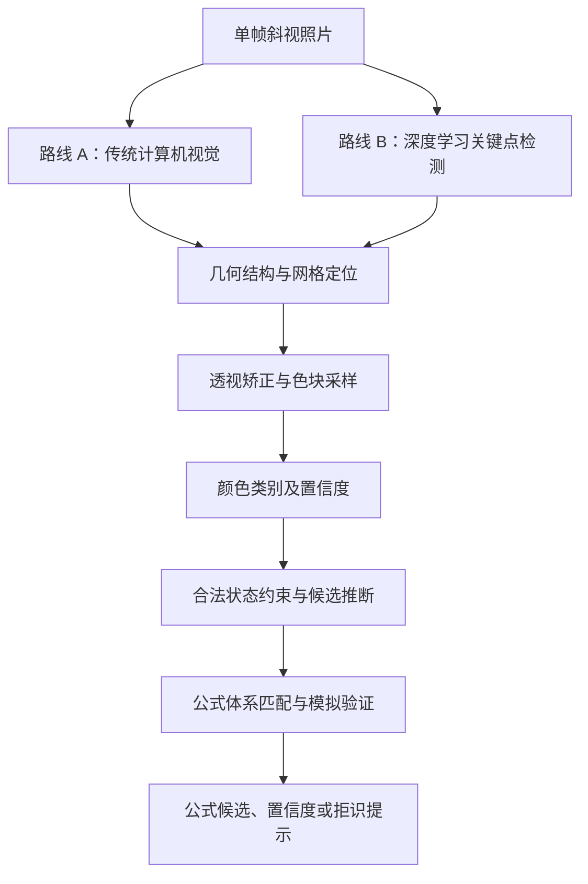

# 基于单帧斜视图像的三阶魔方局部状态推断与公式匹配方法研究

文档用途：SITP 立项研究总纲、技术学习记录、实验设计与 Slidev 汇报上下文。初稿整理于 2026-10-29，持续更新。本文区分已完成原型、正在开展工作与拟研究内容；不把计划中的模型训练写成既有成果。

**当前研究状态（2026-11-04）**：传统计算机视觉版本已实现并接入 cuberoot.me 的拍照查公式页面，能够在一定拍摄条件下从单张斜视照片定位魔方、读取可见色块并匹配公式；复杂背景、光照和拍摄角度下仍有失败情况。深度学习定位模型尚未完成训练，拟作为另一条技术路线开展研究，并与传统视觉方案进行公平对比。AstrBot 的 WCA 插件正在规划／并行接入图片识别查公式能力，作为群聊应用入口。

## 1. 研究定位与题目

**暂定正式题目：基于单帧斜视图像的三阶魔方局部状态推断与公式匹配方法研究**

英文：*Research on Partial State Inference and Algorithm Matching for the Rubik's Cube from a Single Oblique Image*。

学科方向：计算机视觉、图像处理、机器学习、结构化状态推理。核心不是识别某一个特定公式类别，而是研究如何从单张斜视图像中提取有限的可见色块信息，结合魔方结构与合法状态约束，推断可能的魔方状态，再与公式库进行匹配和验证。

**第一阶段受控研究场景**：标准配色三阶魔方，前两层（F2L）已经完整复原并对齐，顶面及两个相邻侧面的顶层区域可见。从图像中提取顶面 9 个色块、两个侧面顶行各 3 个色块，共 15 个可见色块；利用魔方块身份、朝向、排列奇偶性等约束恢复末层状态。该场景是便于建立理论基线、穷举验证和量化实验的起点，不代表整个项目只能识别末层。

**后续扩展方向**：在明确可观测区域与状态先验的前提下，研究部分 F2L 等非末层局部状态。扩展场景需要重新分析可见信息、隐藏块和约束条件，不应直接假定末层的 15 色块证明可以原样套用。

**公式体系不作为核心研究边界**：OLL、PLL、COLL、OLLCP、ZBLL 等是公式库中的不同查询类别，不必人为指定某一类为唯一核心应用。不同体系对状态的适用条件、持握方向、AUF 等要求不同，但可以共用视觉识别与状态推断核心。进阶速拧玩家也是重要用户群体，不能将需求简单定位为新手 OLL／PLL 查询。

### 拟用摘要

> 本项目面向魔方训练与公式查询中的局部状态录入需求，研究基于单帧斜视图像的三阶魔方局部状态推断方法。项目首先以 F2L 已复原的末层场景为受控研究对象，从单张图像中提取顶面及两个相邻侧面的有限色块观测，研究传统计算机视觉与深度学习关键点检测两种几何定位路线，并结合颜色识别、魔方合法状态约束和候选状态验证，实现从局部可见信息到可能状态及适用公式的推断。项目将通过定位误差、色块识别准确率、状态／公式匹配正确率、鲁棒性、拒识率和处理时间等指标进行对照实验，并探索学习模型与几何方法的互补性，最终形成可用于 Web 工具和群聊机器人的拍照查公式原型。

摘要中的传统视觉原型属于前期已完成工作；深度学习模型、系统性数据集、对照实验及混合方案属于拟开展工作，汇报时应明确区分。

## 2. 问题边界与研究内容

### 2.1 第一阶段输入边界

- 标准配色三阶魔方，颜色与面之间的参考关系已知或可由中心块／固定参考系确定。
- 前两层完整复原且各层对齐；这一条件是当前末层状态推断模型的先验，不能仅凭 15 个顶层可见色块自行验证。
- 顶面和两个相邻侧面的顶层区域清晰可见；第一版提取 U 面 3×3 与两个侧面顶行 3×1，共 15 个贴纸颜色观测。
- 图像允许一定范围的位置、尺度、透视角度、背景和光照变化；严重遮挡、反光、模糊、镜像或超出模型适用范围时允许拒识并提示重拍。
- 15 色块唯一确定末层状态的结论依赖上述先验、固定面向约定和合法魔方状态，不应表述为“任意 15 个贴纸都能确定任意魔方状态”。

### 2.2 研究问题

| 研究问题 | 需要回答的具体问题 | 主要研究工作 |
| --- | --- | --- |
| RQ1：视觉感知 | 如何从复杂背景中的单张斜视图像提取可靠几何结构与颜色观测？传统视觉和学习模型各自适用于什么条件？ | 几何定位、关键点检测、透视矫正、颜色识别 |
| RQ2：局部状态推断 | 当只有部分色块可见，且视觉观测存在不确定性时，如何利用魔方结构与合法性约束推断候选状态？ | cubie 状态表示、排列／朝向约束、候选搜索、置信度融合 |
| RQ3：公式匹配与验证 | 如何将推断状态与不同公式体系匹配，并验证公式是否适用？ | 公式库查询、整体转体／AUF 处理、公式模拟验证 |
| RQ4：性能评价 | 两类视觉路线在不同背景、光照、角度和实体魔方上的表现有何差异？ | 数据集、对照实验、鲁棒性和失败案例分析 |

### 2.3 研究内容与交付

| 研究部分 | 具体工作 | 预期交付 |
| --- | --- | --- |
| 视觉感知 | 传统视觉基线分析与优化；训练关键点检测模型；研究混合定位 | 代码、标注规范、模型权重、定位评测 |
| 颜色观测 | 透视矫正后采样色块，输出颜色类别及置信度／概率 | 颜色识别模块、置信度数据 |
| 局部状态推断 | 利用已知前提、角棱身份与朝向、排列奇偶性等筛选合法状态 | 可复现的状态约束模块、候选搜索与不确定性处理 |
| 公式匹配 | 将状态映射到公式库中的适用类别，模拟执行并验证 | 公式查询结果、适用性验证 |
| 应用验证 | Web 页面与 AstrBot 群聊插件接入；可进一步验证 AI 工具调用 | 可演示原型、应用测试记录 |

“训练了模型”是拟开展的研究工作；“传统视觉版本已实现”是前期成果；“在所有环境下可靠识别”尚无证据，不能作为已完成结论。创新性应建立在系统文献调研与实验结果上，不提前宣称首创。

## 3. 已找到的直接参考

以下是首轮调研，未构成完整文献综述。论文、课程报告、开发者自述和工具文档的证据性质不同，不混称为成熟学术成果。

| 来源 | 已核实内容 | 对本项目的用途与阅读边界 |
| --- | --- | --- |
| [1] Stanford CS231n 课程报告，2015 | 使用 CNN 定位魔方及可见面中心，结合传统视觉读取状态 | 优先读摘要、流程、数据采集；它是课程项目报告，不称为顶会论文 |
| [2] 单图魔方状态识别开源项目 | 用迁移学习预测 7 个可见几何角点，再做透视变换和颜色处理 | 最接近实施路线；作者明确报告仍有颜色和面重建错误，本次未复现代码 |
| [3] Ultralytics Pose 文档 | 支持自定义关键点及其训练数据格式 | 确认模型能训练哪些坐标，不需要把人体关键点语义照搬过来 |
| [4] OpenCV 几何变换文档 | 提供四点透视变换与图像重采样方法 | 用来把斜视面展开后分格 |
| [5] Kociemba 的 cubie 表示；[6] Ryan Heise 的魔方约束说明 | 用块位置和朝向描述状态；解释排列奇偶限制 | 用于规范状态表示、合法性条件和补全推理 |
| [7] cubed-core；[8] solve.vision | 已有基于视频的复原重建实现／服务 | 作为相关工作和拓展背景，不能据演示断言任意视频都可准确重建 |

调研发现：自动定位、透视校正、颜色分类已有直接先例，汇报不能写“现有方法均需手动框选”或“尚无相关研究”。本项目应聚焦单张顶层图像、明确输入前提、可复现数据和对照实验。

建议检索词：Rubik's cube keypoint detection；Rubik's cube state recognition；single-image cuboid keypoints；魔方状态识别；魔方关键点检测；结构约束视觉识别。

## 4. 技术路线：视觉感知、约束推理与公式匹配



### 4.1 两条视觉路线

**路线 A：传统计算机视觉（已有原型）**。当前实现使用程序化图像处理与几何特征提取，不依赖针对该任务训练的神经网络。源码涉及 RGB 梯度／Sobel、霍夫直线候选、方向分组、透视网格匹配、候选评分和角点优化等思路；颜色识别与后续状态恢复另有模块。需以当前仓库具体版本为准，逐项核对实现和参数，不能仅凭算法名称推断效果。该方案作为已有 baseline，需要补充可复现测试集、参数记录和失败案例分析。

**路线 B：深度学习关键点检测（拟开展）**。将魔方可见几何结构定义为自定义关键点，使用迁移学习训练轻量定位模型。关键点应服务于面片透视矫正和网格采样；不预设必须设计新网络，也不必一开始进行完整三维姿态估计。先用少量照片验证标注定义和关键点顺序，再扩大数据集训练。

**路线 C：混合方案（探索性）**。例如由学习模型预测关键点或候选区域，再由传统几何约束、网格规则和角点优化进行修正。混合方案不是默认一定更好，需要通过独立测试集验证。

第一轮公平对照应尽量只替换几何定位模块，保持后续透视采样、颜色识别、状态推断和公式验证模块一致。否则难以归因性能差异来自哪个环节。

### 4.2 几何定位、透视矫正与颜色观测

关键点比单纯检测框更贴近需求。矩形框只能给出魔方大致位置，无法直接描述斜视面的四边形和网格。建议先用 20—30 张照片试验标注：为顶面和两个侧面顶行定义角点，约定固定顺序、可见性和共享点处理方式。若把三个区域合并为顶层薄棱柱的几何结构，应明确关键点定义；不要混用“每个面四角”与“整体 7 个可见顶点”两种不同标签协议。

顶面展开为 3×3 网格，两个侧面顶行分别展开为 3×1 网格。应先估计面片四边形并做透视变换（单应性变换），再在矫正后的面片中采样每格内部区域；不能直接在原斜视图像上按像素距离等分。采样应避开贴纸缝隙、边缘、高光和遮挡。

颜色识别可以先使用可解释的基线，例如经过白平衡／曝光校准的 Lab 特征与颜色距离分类，再根据失败案例判断是否需要训练颜色分类器。Lab 空间并不会自动消除光照影响。单张顶层照片不一定包含六种颜色，不能强制假设图像中出现六个颜色簇就能分别代表六个面色。

### 4.3 状态约束与公式匹配

状态模块使用 cubie 级表示描述角块／棱块身份、排列和朝向。第一阶段在 F2L 已复原的约束下，预生成或枚举合法 LL 状态及其 15 色块观测。无噪声时可直接查表；有噪声时结合每个色块的颜色概率进行候选筛选和排序，具体方法见第 9 节。

公式匹配不限定 OLL／PLL。系统根据恢复出的状态和公式库元数据，查询适用的公式类别（例如 OLL、PLL、COLL、OLLCP、ZBLL 等，实际取决于现有库覆盖范围），处理整体转体、持握方向和 AUF 等等价关系，并通过状态模拟验证公式是否达到目标状态。相同状态可能对应多条有效公式，输出时应保留公式选择及必要的执行提示。

### 应用拓展：Web、AstrBot 与多模态智能助手

识别核心与交互入口分离，尽量复用同一套视觉／状态推断／公式匹配模块。

- **cuberoot.me Web 工具**：用户上传或粘贴照片，页面展示几何定位、色块识别、候选状态和公式结果。这是当前传统视觉原型已经接入的应用入口。
- **AstrBot WCA 插件**：计划将图片识别查公式作为既有 WCA 插件的新功能。群友在 QQ 等群聊中发送魔方图片，机器人直接回复识别状态和适用公式，减少跳转网站的步骤。该入口适合作为应用验证，但不应与核心算法研究混为一谈。
- **多模态 AI 工具调用**：后续可将识别能力封装为普通函数接口、MCP 工具或 Agent Skill，使通用模型调用专用识别模块，再结合公式库组织解释。

可以比较通用多模态模型直接回答与调用专用工具后的效果，但应固定模型版本、提示词、图片测试集和评分规则。可设置：模型直接看图；模型看图并可查询公式库；专用视觉提供状态后由模型回答；专用视觉、公式库与执行校验组成完整方案。评价状态识别、公式适用性、AUF／持握提示、阶段目标完成率、拒识和耗时。通用模型在该任务上的表现是待测假设，不预先断言所有模型都不可靠。

## 5. 数据采集与实验方案

### 5.1 数据采集与标注

建议分批投入，先验证标注与几何流程，再扩大数据规模：

1. **20—30 张规则验证集**：检查关键点编号、透视展开、颜色采样区域和状态真值是否正确。可以先人工标点验证后处理，不代表最终产品允许人工框选。
2. **约 200—300 张多样化试验集**：训练第一个关键点定位模型，观察主要错误来自几何定位、光照、颜色还是标签定义。这个数量只是启动预算，不保证充分泛化。
3. **按错误补充数据**：必要时扩展至约 800—1,200 张，优先补充失败角度、不同实体魔方、不同背景和光照，而不是重复采集大量相似帧。

| 数据维度 | 建议记录 |
| --- | --- |
| 对象 | 实体魔方编号、配色、贴纸／无贴纸、磨损及反光特点 |
| 拍摄 | 拍摄批次、设备、角度、距离、背景、照明、压缩情况 |
| 几何标签 | 关键点坐标、编号、可见性、标注协议版本、是否符合输入条件 |
| 状态标签 | 15 格颜色真值、生成／复核状态、F2L 前提是否满足、公式适用性 |
| 预测标签 | 每格颜色类别概率、几何定位置信度、拒识原因、算法版本 |

训练定位模型不需要把 62,208 种末层状态逐一拍摄，但测试集应覆盖多样化的顶层颜色排列，避免只在少数固定图案上测试。测试集必须有可靠真值，不能用模型自己的预测充当标签。

按拍摄批次分组划分训练／验证／测试；来自同一视频的相邻帧留在同一组，避免数据泄漏。条件允许时，另留一颗未参加训练的实体魔方作跨对象测试。所有数据增强在划分后进行；第一版避免镜像增强，任意改变色相也会破坏颜色标签语义。

### 5.2 对照实验

第一轮保持颜色读取、状态推断和公式匹配一致，尽量只改变几何定位模块：

| 配置 | 作用 |
| --- | --- |
| 人工标注关键点＋统一后处理 | 诊断后处理上限，区分定位误差与下游误差；不是自动系统方案 |
| 传统视觉定位＋统一后处理 | 当前已实现基线，评估传统视觉真实表现 |
| 深度学习关键点＋统一后处理 | 评估训练模型相对传统方法的变化 |
| 学习模型＋几何优化＋统一后处理 | 探索混合方法是否具有互补收益 |

评价指标包括：归一化关键点误差、单格颜色准确率、15 格整组完全正确率、状态识别准确率、公式匹配正确率、单图处理时间。耗时必须注明硬件、图像尺寸和运行环境。

若系统允许拒识，同时报告覆盖率（系统给出结果的图片比例）、已输出结果准确率，以及以全部测试图片为分母的正确输出率。不同方案应在相同测试集、相同置信度阈值或相同覆盖率下比较，避免只展示被挑中的成功图片。

### 5.3 状态约束的独立消融

在相同的视觉输出上比较：逐格独立颜色分类；颜色分类＋魔方合法性约束；颜色概率＋合法状态候选评分。这样才能分析状态约束是否提高整组状态准确率、是否降低错误输出，以及是否增加拒识。视觉定位对比和状态约束消融是两个相关但不同的实验维度，不要混成一个结论。

预期交付：一套有划分记录的数据、一套传统视觉基线、一种训练后的关键点定位模型、可复现的状态推断模块、对比实验结果，以及一个能展示识别过程的原型。数值目标应在小规模试验后与导师商定，不在没有测试证据时承诺 95% 或 99% 准确率。

## 6. 立项汇报结构与准备

建议 7 页主体，约 6—8 分钟。汇报重点是问题定义、已有基础、研究路线和实验可行性，不需要把所有实现细节塞进幻灯片。

| 页 | 页面主题 | 核心内容与画面 |
| --- | --- | --- |
| 1 | 选题与研究目标 | 单帧斜视图像、局部状态推断、公式匹配；展示真实输入照片 |
| 2 | 需求背景与问题边界 | 只获取有限可见色块的价值；说明第一阶段 F2L 已复原的受控场景 |
| 3 | 相关工作与研究切入点 | 传统视觉、关键点检测、魔方状态约束已有研究；避免声称无人做过 |
| 4 | 技术路线 | 传统视觉与深度学习两条定位路线，共享透视、颜色、状态推断和公式匹配 |
| 5 | 前期基础与理论可行性 | 展示当前拍照识别原型；说明 15 色块观测和 62,208 状态穷举验证的前提 |
| 6 | 数据与实验设计 | 数据标注、训练／测试划分、对照组、评价指标、置信度与拒识 |
| 7 | 应用场景、进度与预期成果 | cuberoot.me Web、AstrBot 群聊插件、后续 AI 工具调用；列研究阶段与风险 |

Slidev 是适合本项目的代码化演示工具。建议保持统一字体、强调色和布局，以真实照片、网格检测可视化、状态推理流程图作为主要视觉材料；避免每页堆叠大量装饰卡片。演示前准备离线运行版本与 PDF 备份，防止现场网络或浏览器环境异常。

立项前准备优先级：固定题目和输入边界；读完最相关的传统视觉与关键点检测工作；梳理当前仓库的真实算法；准备前期成果截图；确定公平对照实验和数据计划；最后制作 Slidev 并进行模拟问答。立项汇报不要求在立项前完成模型训练。

## 7. 理论说明：修正表述并记录本次验证

前一版证明中“任意两个颜色都能唯一确定一个角块”不成立：两个角块可能共有一对颜色。这里必须同时利用 F2L 限制、可见贴纸所在的面，以及角块颜色的有序关系。

采用固定参考系，四个顶层角块按一致的手性顺序记为 (U,R,F)、(U,F,L)、(U,L,B)、(U,B,R)。每个三元组的三个循环有序相邻对，合计 12 对互不相同。固定角位置允许的旋转保留这种循环次序。因此，在三个侧面可见的顶层角位置，两个按位置排序的贴纸就能区分角块身份和朝向；三贴纸可见的位置更直接。此结论不是对任意未知角块的无序颜色集合成立。

剩下的第四角块由排除确定身份，其朝向由顶面贴纸颜色确定；角块三色互不相同，给定位置和朝上贴纸只剩一种合法旋转摆放。

两个侧面可见的顶层棱块可直接确定身份和朝向。另两个棱块身份最多有两种安排；两种安排只相差一次交换，棱排列奇偶性相反。因为 F2L 已固定、角排列已知，而合法状态要求角棱排列奇偶性相同，最多一种安排合法。已知身份后，其朝向由朝上贴纸确定。实际输入来自合法状态保证至少存在一种，因此恰有一种。

在这个固定参考系下，合法 LL 状态数为：

\[
N=4!\times4!\times3^3\times2^3/2=62\,208.
\]

本次已实际运行下方穷举程序，结果为 62,208 个状态、62,208 个不同 15 色块观测、0 个碰撞组。这验证的是理想的无噪声离散状态模型，不是照片识别准确率，也没有证明 15 个贴纸是最小充分数量。顶面中心是固定参考信息。

这是本次推导和计算检查，不是已发表的原创定理；正式报告仍应核对状态约定，引用魔方约束来源，并保留代码以供复现。

## 8. 视觉观测存在错误时的渐进式约束松弛与候选评分（讨论记录：2026-11-04）

### 8.1 初步想法

用户提出：如果根据当前识别出的颜色无法匹配到任何有效魔方状态，就按置信度从低到高，逐步舍弃置信度最低的色块，再尝试匹配状态，并检查候选是否唯一。这个思路可以作为简单、可解释的错误恢复机制，正式表述为**基于置信度排序的渐进式约束松弛**。

设第 i 个色块的分类器输出颜色概率分布 \(P_i(c)\)，其最高概率类别为 \(\hat c_i\)，置信度可暂记为 \(q_i=\max_c P_i(c)\)。初始候选集合为：

\[
C_0=\{s\in\mathcal S: c_i(s)=\hat c_i,\ i=1,\ldots,15\}
\]

其中 \(\mathcal S\) 是当前研究前提下的合法状态集合，\(c_i(s)\) 表示状态 s 在第 i 个观测位置应出现的颜色。

如果 \(C_0\) 为空，按置信度从低到高，逐个将低置信度位置从“硬性必须等于 top-1 颜色”的约束中放宽，得到候选集合 \(C_1,C_2,\ldots\)。放宽约束只会使候选集合保持不变或扩大：

\[
C_0\subseteq C_1\subseteq C_2\subseteq\cdots
\]

因此，逐步舍弃低置信度观测可以帮助从“没有合法候选”恢复到“存在合法候选”。如果某一步得到唯一候选，可以将其作为在当前硬约束下的唯一解，并进一步用被放宽位置的原始概率检查其可信度。

### 8.2 必须注意的单调性

如果某一步候选集合已经包含多个状态，继续放宽更多色块约束不可能让候选数量减少，因为约束只会变少。因此不能把“不断丢弃色块，直到唯一”为算法承诺。正确处理是：

- 若候选集合为空：继续放宽最低置信度的硬约束。
- 若候选集合恰有一个状态：检查该状态在所有原始颜色概率下是否仍有足够支持，再决定输出或人工确认。
- 若候选集合有多个状态：停止继续放宽，改用全部色块的软概率对候选排序；若最佳与次佳候选差距不足，则报告歧义或请求用户修正／补拍。

这一区分很重要：放宽约束能修复“无解”，但不能凭空消除“多解”。

### 8.3 软概率候选评分

对候选状态 s，可使用独立色块概率的对数似然作为初始评分：

\[
S(s)=\sum_{i=1}^{15}\log\big(P_i(c_i(s))+\epsilon\big)
\]

其中 \(\epsilon\) 是避免对数零值的极小正数。即使某个位置已从硬约束中放宽，它的原始概率仍应保留在评分中，不应把视觉信息彻底丢弃。可进一步纳入几何定位质量、采样质量或位置权重，但这些权重需要通过验证集校准，不能凭直觉任意设置。

根据最高分候选与次高分候选的分差、概率比或校准后的置信度，设置三种输出：自动确认；展示多个候选并请求用户选择；拒识并提示调整角点或重新拍摄。概率分数只有在分类器校准合理时才可解释为可信度；若模型未校准，应先评估温度缩放、可靠性图等校准方法，或仅将其作为排序分数。

### 8.5 状态不唯一时的公式层查询：已有系统实现（代码核对：2026-11-04）

用户补充：不应把“先恢复唯一魔方状态”作为所有公式查询的前置条件。不同公式体系对状态信息的要求不同；某些公式类别只约束状态的某些属性，因此多个完整状态候选仍可能共享同一条适用公式。以 OLL 为例，其阶段目标是顶层所有角块与棱块朝向正确，不要求这些块的排列已经复原。只要同一条 OLL 公式对所有保留状态候选模拟执行后都达到 OLL 目标，就可以在状态尚未唯一确定时返回该公式。

**这不是纯粹的未来设想：cuberoot.me 当前拍照识别代码已经包含这一层处理。** 已核对以下实现：

- [`recognize.ts`](https://github.com/2017YANR02/cuberoot.me/blob/main/core/packages/shared/src/cube-photo/recognize.ts)：`completeLastLayer` 根据已观测贴纸和 F2L 已复原约束枚举所有兼容的合法末层补全。`recognizePhoto` 在恰有一个候选时返回 `ok`，多个候选时返回 `partial`，并明确要求 `partial` 包含全部兼容补全，不能把截断样本伪装成穷举结果；超过候选数量上限时转为歧义状态，而不是声称候选完整。
- [`lookup.ts`](https://github.com/2017YANR02/cuberoot.me/blob/main/core/packages/shared/src/cube-photo/lookup.ts)：`photoRecognitionSets` 对 `partial` 结果求各候选共同支持的公式体系；`matchingPhotoAlgs` 遍历公式库中的具体公式，并对每一个状态候选模拟执行同一条公式，只有当它对全部候选都满足该公式体系的目标条件时，才产出匹配。
- 同文件的 `photoAlgGoal` 为不同公式体系定义各自的完成条件：OLL 使用 `isOll(state)`，只要求顶层朝向完成；OLLCP／COLL 还要求顶层角块复原；完整求解类目标则要求整个状态复原。CMLL 使用其对应的步骤完成判定。

因此，系统应区分三个层次：

1. **视觉观测是否足以确定唯一状态**：由可见色块、颜色不确定性和魔方合法性约束决定。
2. **候选状态是否共同支持某个公式体系／具体公式**：即使状态有多个候选，也可能存在共同适用的公式。
3. **公式是否对所有候选都有效**：必须对每个候选状态应用同一条公式并模拟验证，不能只在第一个候选上验证。

这比“必须唯一识别状态才能查公式”更符合真实速拧查询需求，也使公式体系的目标条件成为状态不确定时仍可利用的信息。注意，不能简单地说 OLL 只看黄色贴纸：OLL 的分类与公式选择仍依赖完整的顶层朝向图案；这里的关键是 OLL 的**完成目标不要求排列复原**，因此多个排列不同但朝向相关的候选，可能共享同一条 OLL 公式。

### 8.6 与渐进式约束松弛的关系

公式层查询与置信度驱动的观测松弛解决的是不同问题，不应互相替代：

- 当观测与所有合法状态都冲突、候选集为空时，才考虑逐步放宽低置信度贴纸的硬约束，恢复可能状态。
- 当候选集非空但包含多个状态时，不应为了追求唯一状态而继续丢弃观测；应先保留完整候选集，检查是否存在共同公式体系和共同适用公式。
- 如果没有共同公式，再考虑使用原始颜色概率对候选排序、请求用户确认或补拍。概率排序不能代替“公式对所有候选均有效”的模拟验证。

因此，一个更合理的整体决策顺序是：**先生成合法候选 → 若无候选则处理低置信度观测 → 若有多个候选则优先做公式层交集与逐候选模拟验证 → 仍无法确定时再做概率排序／人工确认／拒识。** 这一顺序尽量保留观测信息，也避免把“状态唯一”误当成“公式查询成功”的必要条件。

### 8.4 需要进一步实验的问题

1. 仅按 top-1 最大概率排序是否足够，还是应同时考虑 top-1 与 top-2 的差距、熵和分类器校准情况？
2. 放宽一个位置时，是完全忽略其硬标签，还是允许其 top-k 颜色作为候选？
3. 对 62,208 个合法 LL 状态进行全量概率评分的计算成本如何？预计状态规模较小，可先做穷举基线，再根据实测决定是否需要索引或剪枝。
4. 状态唯一性与公式唯一性不同：多个状态可能对应同一条对所有候选都适用的公式。cuberoot.me 的 `lookup.ts` 已实现候选状态共同公式体系筛选，并逐个模拟候选状态验证同一条公式；OLL 的完成条件只要求朝向完成，不要求排列复原。此处应作为已有系统能力记录，而不是仅列为未来设想。
5. 对于不满足当前 LL 先验的照片，状态库可能不适用。系统需要识别输入前提不满足或无候选的情况，不能把所有无解都归因于颜色识别错误。

**当前结论**：渐进式约束松弛是一个可实现的初步方案；更完整、信息损失更少的方案是“硬约束候选生成＋软概率评分＋置信度／分差决策”。应通过合成错误注入和真实照片测试比较两者的状态准确率、覆盖率、错误自动确认率与处理时间。

## 9. 参考资料

1. Jay Hack, Kevin Shutzberg. *Rubiks Cube Localization, Face Detection, and Interactive Solving*. Stanford CS231n course report, 2015. https://cs231n.stanford.edu/reports/2015/pdfs/jaykevin_final.pdf
2. elfarhan. *Rubiks-cube-state-recognition-from-an-image*. README 与仓库目录已查阅，代码未复现。https://github.com/elfarhan/Rubiks-cube-state-recognition-from-an-image/
3. Ultralytics. *Pose Estimation*；*Pose Estimation Datasets*. https://docs.ultralytics.com/tasks/pose/ ；https://docs.ultralytics.com/datasets/pose/
4. OpenCV. *Geometric Transformations of Images*. https://docs.opencv.org/4.x/da/d6e/tutorial_py_geometric_transformations.html
5. Herbert Kociemba. *The Cubie Level*. https://www.kociemba.org/math/cubielevel.htm
6. Ryan Heise. *Laws of the cube*. https://www.ryanheise.com/cube/cube_laws.html
7. KingBobJoeIV. *cubed-core*. https://github.com/KingBobJoeIV/cubed-core
8. *solve.vision*. 产品页面，未自行上传视频测评。https://solve.vision/


### 2026-11-04：状态不唯一时的公式匹配

- 用户指出，不同公式体系对状态信息的要求不同：例如 OLL 目标只要求顶层朝向完成，不要求排列复原。因此多个完整状态候选仍可能支持同一条公式；不应将唯一状态恢复设为公式查询的必要前提。
- 核对 cuberoot.me `recognize.ts`：多候选识别结果以 `partial` 表示，并要求候选集合完整；候选溢出时拒绝把截断集合当作完整结果。
- 核对 `lookup.ts`：对多候选求共同支持的公式体系；对公式库中的同一条公式逐一模拟所有候选，只有全部满足对应公式体系的目标条件才返回。OLL 的目标判定为 `isOll`，而 OLLCP／COLL 还有角块复原条件。
- 研究设计修订：把“候选状态恢复”和“候选状态上的共同公式验证”视为两个不同层次。只有候选为空时才考虑放宽低置信度观测；候选多个时优先查询共同公式，不应继续丢弃信息以强求唯一状态。

## 附录 A：无第三方依赖的穷举验证代码

将下方保存为 Python 文件后执行即可。角／棱顺序与常用 cubie 表示一致；U1—U9 为从 U 面正视的行优先编号，F1—F3、R1—R3 为对应侧面顶行。只枚举合法状态，不模拟真实图像。

```python
from itertools import permutations, product
from collections import Counter

cpieces = ['URF', 'UFL', 'ULB', 'UBR']
epieces = ['UR', 'UF', 'UL', 'UB']
cslots = [
    ['U9', 'R1', 'F3'], ['U7', 'F1', 'L3'],
    ['U1', 'L1', 'B3'], ['U3', 'B1', 'R3'],
]
eslots = [['U6', 'R2'], ['U8', 'F2'], ['U4', 'L2'], ['U2', 'B2']]
observed = (
    [f'U{i}' for i in range(1, 10)]
    + [f'F{i}' for i in range(1, 4)]
    + [f'R{i}' for i in range(1, 4)]
)

def parity(p):
    return sum(p[i] > p[j] for i in range(4)
               for j in range(i + 1, 4)) % 2

seen = Counter()
for cp in permutations(range(4)):
    for co3 in product(range(3), repeat=3):
        co = (*co3, (-sum(co3)) % 3)
        corners = {'U5': 'U'}
        for pos, piece in enumerate(cp):
            for n, color in enumerate(cpieces[piece]):
                corners[cslots[pos][(n + co[pos]) % 3]] = color
        for ep in permutations(range(4)):
            if parity(ep) != parity(cp):
                continue
            for eo3 in product(range(2), repeat=3):
                eo = (*eo3, sum(eo3) % 2)
                facelets = dict(corners)
                for pos, piece in enumerate(ep):
                    for n, color in enumerate(epieces[piece]):
                        facelets[eslots[pos][(n + eo[pos]) % 2]] = color
                key = ''.join(facelets[p] for p in observed)
                seen[key] += 1

print({
    'states': sum(seen.values()),
    'unique_observations': len(seen),
    'collision_groups': sum(v > 1 for v in seen.values()),
    'largest_group': max(seen.values()),
})
```

本次运行输出：

```json
{"states": 62208, "unique_observations": 62208, "collision_groups": 0, "largest_group": 1}
```


## 附录 B：研究讨论更新记录

### 2026-11-04：研究范围与应用入口修订

- 核心研究从“末层识别”扩展为“单帧斜视图像下的局部状态推断与公式匹配”。末层／F2L 已复原作为第一阶段受控实验场景，未来可扩展到部分 F2L 等其他局部情况。
- OLL、PLL、COLL、OLLCP、ZBLL 等公式类别不作为研究范围的边界。重点是状态推断与公式库的通用匹配能力，兼顾进阶速拧玩家的查询需求。
- 应用入口包括 cuberoot.me Web 工具，以及正在规划／并行开发的 AstrBot WCA 插件图片查公式功能；AI 工具调用作为进一步扩展。
- 明确传统视觉原型已经实现，深度学习关键点模型尚待训练；两条路线需要优化并在同一数据集和统一下游模块下比较。

### 2026-11-04：噪声观测处理方案

- 用户提出按置信度从低到高逐步舍弃色块观测，直到能够匹配有效状态并检查唯一性。
- 将其整理为“渐进式约束松弛”；补充候选集合随约束放宽单调扩大的性质：若已经出现多个候选，继续丢弃观测不会恢复唯一性。
- 后续采用硬约束候选生成与软概率评分结合的方向，并区分状态唯一性、公式唯一性和稳健公式交集。

## 10. 从状态可辨识性到任务可辨识性：候选状态上的公式稳健性（讨论补充：2026-11-04）

### 10.1 两种不同的可辨识性

**状态可辨识性（state identifiability）**：给定图像观测与输入先验，合法状态候选集合是否只包含一个完整魔方状态。若候选集合为 \(C\)，则 \(|C|=1\) 时状态唯一；\(|C|>1\) 时完整状态仍有歧义。

**任务可辨识性（task identifiability）**：即使 \(|C|>1\)，针对某个指定任务，是否存在同一个操作／公式，使它对集合中的每个候选状态都满足该任务的目标条件。任务可辨识性不要求完整状态唯一，而要求任务结果在所有可能状态下保持一致。

因此，公式查询不应被设计成“先恢复唯一完整状态，再查询公式”的单一路径。应根据公式体系自己的目标条件，直接判断候选状态能否支持共同公式。

### 10.2 公式体系具有不同的信息需求

OLL 的目标是顶层朝向完成，并不要求顶层块的排列已经复原。因此，多个排列不同但顶层朝向相同或可由同一公式处理的候选状态，可能共享同一条 OLL 公式。相较之下，PLL 等要求更完整排列信息的任务，通常不能在任意多个不同状态候选之间直接共用完整解法。COLL、OLLCP、ZBLL 等体系也各有其目标条件与状态限制，不能仅凭类别名称推断其信息需求，必须以公式库的具体目标判定和逐候选模拟为准。

应避免将 OLL 简化描述为“只看黄色贴纸”：OLL 的目标是整个顶层所有角块和棱块的朝向正确，而不是只识别 U 面颜色图案。

### 10.3 对候选集合进行共同公式验证

设视觉与状态推断得到完整候选集合 \(C=\{s_1,\ldots,s_n\}\)，公式库中某条公式为 \(a\)，公式体系对应的目标谓词为 \(G_T(s)\)。定义公式对候选集合稳健适用，当且仅当：

\[
\forall s\in C,\quad G_T(a(s))=\mathrm{true}
\]

其中 \(a(s)\) 表示在状态 \(s\) 上模拟执行公式后的状态；若公式体系允许 AUF、整体转体或持握方向变化，这些等价变换也应纳入匹配过程，并对每个候选状态验证同一条最终输出公式及其执行约定。

实际实现可按以下顺序进行：

1. 生成并保留完整、未截断的合法状态候选集合；如果候选枚举达到上限而无法证明集合完整，不得把部分样本冒充全部候选。
2. 根据候选状态判断哪些公式体系对整个候选集合都有定义且适用。
3. 遍历相应公式库，考虑允许的 AUF／方向对齐。
4. 对每条候选公式，在每个状态候选上模拟执行，并检查该公式体系自己的完成条件。
5. 仅当同一条公式对全部候选均通过验证时，才将其作为稳健公式返回；否则返回其他可验证结果、候选列表或歧义提示。

这意味着系统可以出现“完整状态不唯一，但公式查询结果唯一”的有效结果。输出时应明确这是对当前候选集合成立的共同公式，而不是声称已经恢复唯一完整状态。

### 10.4 与置信度恢复策略的关系：更新后的决策顺序

1. **先生成合法候选**：利用可靠色块观测与魔方约束生成状态候选，并记录候选集合是否完整。
2. **候选唯一**：进入常规公式库匹配与模拟验证。
3. **候选多个**：优先进行任务可辨识性检查，搜索对全部候选都成立的共同公式；不要为了追求完整状态唯一而立即丢弃观测。
4. **共同公式不存在或目标类别不支持多候选**：再考虑按视觉置信度放宽低可信观测，重新生成候选；放宽约束只能维持或扩大候选集合，不能把已经多解的集合变回唯一。
5. **仍有多个候选**：使用原始颜色概率对候选状态评分；若候选之间的差异影响公式结果，则展示候选／请求用户校正或补拍；若差异不影响某个任务，则仍可返回经逐候选验证的共同公式。
6. **没有合法候选**：检查颜色误分类、几何定位、颜色参考系、F2L 前提不成立或输入超出模型范围，不应一律归因于某个低置信度色块。

### 10.5 已有代码依据与研究价值

当前 cuberoot.me 的 `core/packages/shared/src/cube-photo/recognize.ts` 已将识别结果区分为 `ok`、`partial`、`corners-only`、`uncertain-colors`、`ambiguous`、`invalid` 等状态；`partial` 表示多个兼容的完整状态候选，并明确要求候选集合完整，不能将被数量上限截断的候选列表当作穷举结果。

`core/packages/shared/src/cube-photo/lookup.ts` 中，`photoRecognitionSets` 会对多个候选分别计算可用公式体系，再取共同支持的类别；`matchingPhotoAlgs` 会对同一条公式逐个模拟所有候选状态，只有全部候选都满足 `photoAlgGoal` 才产出匹配。代码中的 OLL 目标通过 `isOll` 判断，而 COLL／OLLCP 还要求顶层角块复原。这是项目已有实现，应作为前期工作和系统设计依据，而不是包装成尚未实现的创新点。

本项目后续研究重点应从“提出候选状态交集公式匹配”转向：系统评估它在不同公式体系、候选数量、视觉噪声与状态歧义下的正确率、覆盖率和计算开销；分析哪些任务条件允许更少的观测信息；以及如何将该机制与传统视觉／学习模型输出的置信度结合。


## 11. 技术学习记录：传统计算机视觉流水线的整体逻辑（2026-11-04）

本节用于本科生理解和立项答辩，不要求逐行掌握源码或自行实现每个算子。学习目标是能说明各阶段解决的问题、输入输出、选择理由及主要局限。

### 11.1 几何定位：从背景中找到魔方网格

计算机最初只得到像素矩阵，并不知道哪个区域是魔方。传统视觉方案利用魔方贴纸边界、外轮廓和规则网格等先验：先寻找像素亮度／颜色变化明显的边缘，再从边缘点中提取方向一致的直线候选，最后根据三阶魔方网格的几何规律组合、评分并确定可见面的角点。

当前原型涉及 Sobel 梯度与霍夫直线检测等方法。Sobel 用于估计图像在水平和垂直方向的局部变化，突出可能的边缘；霍夫变换将边缘点组织起来寻找直线。两者提供的是候选特征，不会自动理解“这是魔方”，仍需后续几何约束筛选。斜视下的正方形会投影成一般四边形，因此不能简单依赖标准正方形轮廓。

局限：复杂背景中的窗框、键盘、桌面纹理也可能产生大量边缘和直线；遮挡、反光、低对比度及极端透视会使真实网格缺失或产生干扰候选。这也是后续考虑学习模型辅助定位的原因。

### 11.2 透视矫正：把斜视面映射成规整网格

定位角点后，程序已知某个魔方面片在原图中的四边形范围。通过平面单应性／透视变换，把该四边形映射到规整矩形，再按 3×3 网格划分并在每个贴纸内部采样。其目的不是简单旋转图片，而是补偿平面在斜视拍摄中产生的透视缩放与形变，使每个采样区域尽可能对应真实贴纸内部。

透视矫正依赖角点质量：角点偏差会使整个网格采样偏移，继而造成颜色误判。因此几何定位误差会向后传播，影响色块识别和最终状态恢复。

### 11.3 颜色识别：比较颜色而不是只看 RGB 阈值

每个矫正后的贴纸区域提取代表颜色，再与标准魔方颜色参考比较。RGB 数值容易随光照和曝光变化；Lab 颜色空间将颜色表示为明度 L*、红绿轴 a*、黄蓝轴 b*，通常更适合表达感知颜色差异。当前原型在 Lab 空间计算与参考颜色的距离，并结合距离间隔、阈值、曝光补偿和同一照片中高置信度样本的有限校准，决定颜色类别及其可靠性。

Lab 并不能消除光照影响，颜色距离也不是天然校准好的概率。应将“分类类别”“分类置信度／可靠性”和“概率分布”区分开；当前代码中的 margin、distance 和 reliable 是判定依据，不应未经校准就称为统计概率。

### 11.4 状态约束：从局部色块到合法魔方状态

颜色分类后，系统不应立即把每个贴纸独立结果当成最终答案，而应把它们组合成角块、棱块的身份与朝向观测，再利用魔方合法状态约束筛选候选。第一阶段的受控场景利用 F2L 已复原这一先验，并结合角块扭转总和、棱块翻转总和、角棱排列奇偶性等条件，恢复可能的 LL 状态。该领域约束可以发现部分互相矛盾的颜色观测，但不能保证纠正任意视觉错误；错误观测也可能偶然对应另一个合法状态。

### 11.5 公式匹配：按任务目标验证，而非只做状态分类

候选状态确定后，系统查询公式库，并通过状态模拟验证公式是否满足对应公式体系的目标条件。若完整状态存在多个候选，不必立即认定无法查询：不同公式体系对状态信息的需求不同，可以检查同一条公式是否对全部候选都满足该体系目标。状态唯一性与任务／公式可辨识性应分别评价。

### 11.6 传统视觉路线的一句话总结

**边缘与直线帮助定位几何结构，透视变换把斜视面展开，颜色空间帮助识别贴纸，魔方合法性约束恢复候选状态，公式模拟验证最终查询结果。** 这条流水线的优势是可解释、无需针对魔方照片训练神经网络，并能利用明确的几何与领域先验；主要风险是手工特征和阈值容易受复杂背景、光照、遮挡与拍摄角度影响。

答辩时应把传统视觉描述为“已有可运行原型及初步验证”，把系统化数据集、深度学习定位模型、统一测试集对照与混合方案描述为“拟开展研究”。

### 2026-11-04：技术学习颗粒度调整

用户明确：当前阶段不需要深入学习深度学习模型结构、CNN 数学细节、损失函数或具体模型训练实现。深度学习目前定位为后续与传统视觉结合、对比和优化的研究路线；现阶段只需掌握关键概念及其在项目中的作用，例如关键点检测、标注数据、迁移学习、训练／验证／测试集。具体模型选型与训练细节应等整体研究设计、数据集方案和传统视觉基线梳理清楚后再展开。

后续讨论采用更大的推进颗粒度：优先讨论研究问题、整体技术路线、数据与实验设计、评价指标、阶段产出和风险；避免逐个源码函数或算法公式展开，除非用户主动要求或某个概念是理解研究决策的必要前提。讲解以“是什么、在本项目里负责什么、为什么这样安排”为主。

## 12. 国内外相关研究进展与本项目切入点（首轮文献调研：2026-11-04）

> 本节是面向立项汇报的首轮专题调研，不等于穷尽式系统综述。已核对论文摘要／可访问正文、出版页面或项目 README 的内容；不同来源的证据等级不同。后续正式报告应补齐完整作者、卷期页码、DOI、引用格式，并继续检索近五年相关工作。

### 12.1 代表性工作

| 时间与来源 | 研究任务与主要方法 | 对本项目的启示 | 与本项目的区别／局限 |
| --- | --- | --- | --- |
| 2007，Kasprzak、Szynkiewicz、Czajka，*Rubik's Cube Reconstruction from Single View for Service Robots*，Machine Graphics & Vision 16(2–3), 451–459 | 面向服务机器人，从单视角图像定位魔方并识别最多三个可见面的色块；利用颜色处理、区域／单元检测、分组与表面重建，并使用魔方结构先验简化单视角重建。 | 证明“单视角魔方视觉重建”本身已有较早研究；已知几何结构和颜色先验可以显著降低视觉重建难度。 | 目标是机器人操作所需的可见表面／物体重建，不是利用有限顶层色块推断末层状态并匹配速拧公式。实验环境和光照校准假设较受控。 |
| 2014，*Robust Rubik’s Cube Detection Using Hough Transform and Advanced Clustering Functions*，Applied Mechanics and Materials 613, 253–264 | 研究魔方位置与颜色检测，使用霍夫变换和聚类方法，目标是应对相机与魔方位置不固定、遮挡和光照变化等问题。 | 与当前传统视觉路线高度相关，可作为边缘／直线检测、聚类和颜色识别的直接参考。 | 重点仍是检测和颜色提取；不能据摘要推断其覆盖本项目的局部状态约束推理和公式任务匹配。需要进一步获取全文核实具体实验设置和指标。 |
| 2015，Jay Hack、Kevin Shutzberg，Stanford CS231n 项目报告 *Rubiks Cube Localization, Face Detection, and Interactive Solving* | 使用 CNN 定位魔方，再使用 CNN 检测可见面中心；结合 K-means、SLIC 超像素、RANSAC 透视变换和颜色分类提取状态。报告还提出迭代式辅助标注／自举数据采集流程。 | 是“学习模型负责定位、传统视觉负责几何与颜色处理”的早期混合路线实例；可借鉴数据采集、关键点／面中心标注和统一后处理设计。 | 属于课程项目报告而非同行评审期刊论文；目标是摄像头场景下的状态录入／交互求解，不是本项目定义的 15 色块局部推断与多公式体系查询。 |
| 2019，Liu 等，*Color Recognition for Rubik's Cube Robot*，arXiv:1901.03470 | 专门研究魔方机器人颜色识别，比较离线训练式 SB-ELM 与两种在线标签传播方法，讨论持续光照变化引起的 color drifting，并利用中心块颜色作为弱标签信息。 | 提醒颜色识别不只是选 RGB／HSV／Lab 距离的问题；光照变化和颜色漂移需要专门处理。中心块／已知颜色关系也可以作为弱监督先验。 | 重点是颜色分类和机器人场景，不涉及单帧几何定位与局部公式推断。arXiv 预印本，引用时应注明其预印本属性。 |
| 2022 年会议，2023 年收录于 IEEE Xplore，Wang 等，*Research on State Recognition of Rubik's Cube Based on Monocular Vision*，DOI: 10.1109/ICSPS58776.2022.00141 | 使用单目相机采集魔方颜色与几何轮廓信息，利用 KNN 区分相近颜色（特别是黄、橙、红），并利用相邻块位置关系判断魔方旋转／识别状态；用于机器人／自动求解流程。 | 说明单目视觉、颜色分类和几何关系结合仍是魔方状态识别的有效路线；可作为较近年的学术参考。 | “单目视觉”不等于“单张静态照片”；研究目标和系统交互涉及机器人识别流程，不能直接视为与本项目任务完全相同。当前可访问的 IEEE 页面只显示摘要元数据，正式引用前应获取全文核查实验细节。 |
| 公开项目，elfarhan，*Rubik's Cube State Recognition from an Image*（GitHub） | 从单张图像预测七个可见几何角点，使用 VGG16 迁移学习；透视提取可见面，HSV 与 K-means 聚类识别贴纸颜色。README 记录了约 40 张自采图、约 600 张网络图和约 400 张视频追踪图；作者指出面重建和颜色分割仍有错误。 | 与本项目计划中的关键点检测路线直接相关，可参考七个可见顶点的标注方式、视频辅助标注、数据增强和透视后处理。也说明训练数据数量并不自动保证可靠结果。 | 是个人开源实现，不是正式学术论文；作者报告为部分成功，不能作为成熟性能基准。其目标是从单张图像重建完整可见／完整状态，与本项目的局部状态推断目标不同。 |
| 2025，Wang、Luo、Wu，*VisionCube: 3D-Aware Vision-Language Model for Multi-Step Spatial Reasoning*，CVPR Workshops | 将魔方作为多步空间推理和具身智能任务，结合多视角信息、几何先验、视觉语言模型与状态／轨迹数据。 | 可作为魔方与多模态空间推理结合的前沿背景，支持未来将专用识别工具接入通用 AI 助手的应用展望。 | 研究重点是多视角空间理解和求解规划，不是单帧局部视觉识别；不应作为传统 CV 与关键点检测对比的直接基线。 |

### 12.2 研究进展的归纳

首轮资料显示，魔方视觉识别并非空白领域，至少已有以下几类研究路径：

1. **传统图像处理与几何先验**：颜色空间归一化／阈值、边缘与直线、轮廓或区域分割、几何矩、聚类、网格／表面分组。其优势是规则明确、计算开销可控；局限是阈值和手工特征容易受到背景、光照、反光、遮挡和透视变化影响。
2. **学习模型辅助定位**：CNN 或迁移学习模型预测魔方区域、面中心或几何关键点，再由传统视觉完成透视变换、色块提取和颜色分类。已有工作证明混合流水线具有可行性，也提供了辅助标注和数据扩充的参考。
3. **颜色识别与自适应校准**：研究者针对颜色漂移、相近色区分、中心块先验和在线标签传播提出专门方法。说明颜色模块需要独立评价，不能将几何定位成功等同于状态识别成功。
4. **机器人与交互求解系统**：不少工作以完整状态录入、机器人抓取／转动和自动求解为目标，视觉模块是更大系统的一部分。其输入条件、输出目标与面向速拧玩家的公式查询工具不完全相同。
5. **多模态空间推理**：近期开始出现将魔方作为 3D 空间理解、连续操作规划和视觉语言推理任务的研究，但与本项目的局部状态识别仍属于相邻方向。

### 12.3 本项目与已有工作的差异：可主张的切入点

目前不宜声称“首次实现单张照片识别魔方”或“传统视觉魔方识别尚无人研究”。2007 年已有单视角魔方重建，2015 年已有 CNN 与传统视觉结合的魔方定位／面识别流水线，2014 年也已有霍夫变换与聚类检测研究。

更准确、可验证的研究切入点是：

- **任务定义不同**：不是要求从照片录入完整六面状态，而是在明确先验下，从一张斜视图像提取有限的局部可见色块，并推断与目标查询任务有关的状态信息。
- **利用魔方合法性约束**：将视觉识别结果与 cubie 身份、朝向、排列奇偶性等结构约束结合，研究局部观测到合法状态候选的推断过程。第一阶段以 F2L 已复原的末层场景作为可证明、可穷举验证的受控起点。
- **从状态识别延伸到公式任务匹配**：完整状态不唯一时，仍可依据公式体系自身的目标条件，验证是否存在对全部候选状态都适用的共同公式。区分状态可辨识性与任务可辨识性，是当前产品逻辑中值得系统评价的特点。
- **面向真实使用入口**：在 Web 公式查询和 AstrBot 群聊图片查询中验证同一识别核心，面向速拧玩家多种公式体系，而非仅面向机器人完整复原流程。
- **可复现的路线对照**：在统一测试集和统一后处理条件下，对传统视觉、学习模型定位及混合方案进行比较，并独立评价状态约束与共同公式验证的贡献。

以上属于“研究切入点与潜在贡献”，尚不能直接写成已证实的创新点。需要通过更系统的数据库检索、对比文献和实验结果，进一步确认相关工作是否已有相同任务定义与方法组合。

### 12.4 对立项汇报可直接使用的研究现状表述

> 现有魔方视觉识别研究主要围绕单视角／多视角下的魔方定位、可见面重建、贴纸颜色识别以及完整状态录入展开。早期研究已利用颜色空间处理、区域分割和几何约束实现单视角魔方重建；后续工作进一步引入霍夫变换、聚类、卷积神经网络和迁移学习，并形成学习模型定位与传统视觉后处理相结合的技术路线。针对颜色漂移和相近颜色识别，也已有基于颜色校准与标签传播的研究。总体而言，魔方视觉识别的基础技术已有较多探索，但现有工作多以完整状态获取或机器人求解为目标。针对速拧公式查询中“单帧斜视图像、有限局部色块、利用魔方合法性约束推断候选状态，并在状态不唯一时验证共同适用公式”的任务链条，仍有进一步研究和系统评价的空间。本项目拟以传统视觉原型为基线，引入学习模型改善几何定位，并通过统一数据集和对照实验分析不同方法的适用条件与性能差异。

### 12.5 文献与项目链接

1. Kasprzak, W., Szynkiewicz, W., & Czajka, Ł. (2007). *Rubik's Cube Reconstruction from Single View for Service Robots*. Machine Graphics & Vision, 16(2–3), 451–459. [ResearchGate 页面及作者上传全文](https://www.researchgate.net/publication/234829781_Rubik%27s_cube_reconstruction_from_single_view_for_Service_robots)。
2. *Robust Rubik's Cube Detection Using Hough Transform and Advanced Clustering Functions*. Applied Mechanics and Materials, 613, 253–264. [DOI: 10.4028/www.scientific.net/AMM.613.253](https://doi.org/10.4028/www.scientific.net/AMM.613.253)。
3. Hack, J., & Shutzberg, K. (2015). *Rubiks Cube Localization, Face Detection, and Interactive Solving*. Stanford CS231n course project report. [PDF](https://cs231n.stanford.edu/reports/2015/pdfs/jaykevin_final.pdf)。
4. Liu, S., et al. (2019). *Color Recognition for Rubik's Cube Robot*. arXiv:1901.03470. [arXiv](https://arxiv.org/abs/1901.03470)。
5. Wang, M., Wang, Y., Shi, Q., & Li, S. (2022). *Research on State Recognition of Rubik's Cube Based on Monocular Vision*. 2022 14th International Conference on Signal Processing Systems. DOI: 10.1109/ICSPS58776.2022.00141. [IEEE Xplore](https://ieeexplore.ieee.org/document/10218571/)。
6. elfarhan. *Rubik's Cube State Recognition from an Image*. GitHub repository. [项目主页](https://github.com/elfarhan/Rubiks-cube-state-recognition-from-an-image)。
7. Wang, F., Luo, N., & Wu, W. (2025). *VisionCube: 3D-Aware Vision-Language Model for Multi-Step Spatial Reasoning*. CVPR Workshops 2025. [CVPR Open Access](https://openaccess.thecvf.com/content/CVPR2025W/eLVM/html/Wang_VisionCube_3D-Aware_Vision-Language_Model_for_Multi-Step_Spatial_Reasoning_CVPRW_2025_paper.html)。

### 2026-11-04：首轮研究现状调研记录

- 已确认“单视角魔方重建”“传统视觉检测”“CNN／迁移学习定位＋传统视觉后处理”均有明确先例，项目创新性不能建立在“此前没有人做过单图魔方识别”这一表述上。
- 本轮最重要的定位修正：将项目差异放在局部可见信息下的约束状态推断、状态不唯一时的任务／公式可辨识性，以及面向公式查询的端到端任务定义和系统评价。
- 后续需要补充更系统的检索：Google Scholar、IEEE Xplore、Scopus／Web of Science（若学校可访问）及中文学术数据库；检索词包括 Rubik's cube partial state recognition、local state inference、single image cube recognition、constraint-based state estimation、algorithm lookup from image 等。重点核查是否已有与“局部 15 贴纸＋F2L 先验＋多公式共同适用性验证”完全相同的工作。

## 13. 立项汇报范围与研究推进颗粒度调整（2026-11-04）

用户进一步明确：当前项目已有可运行的传统计算机视觉原型，现阶段并非以训练深度学习模型为主要实施路线；立项汇报是本科 SITP 前期汇报，不需要把模型训练、数据集建设、消融实验和复杂评价体系展开到论文级别。此前提出的“传统视觉与深度学习两条路线进行完整、同等规模对照”的表述过于超前，应调整为阶段性、可执行的研究计划。

### 13.1 当前研究工作的真实定位

- **已有基础**：基于传统计算机视觉的单帧斜视魔方识别原型已经实现，并集成到 cuberoot.me 的拍照查公式功能；具备初步真实照片使用效果。该成果是当前项目的前期基础和立项汇报重点。
- **当前核心工作**：梳理、理解并优化已有视觉流水线；分析不同背景、光照、角度和遮挡条件下的识别表现；完善识别失败与不确定观测的处理；结合魔方合法状态约束和公式体系目标条件，提高结果可靠性。
- **后续探索方向**：在传统视觉方案遇到明显瓶颈时，再尝试使用深度学习关键点检测等方法辅助几何定位，或探索学习模型与几何先验结合。模型训练属于后续可行的优化方向，不是当前已经完成的工作，也不应在立项汇报中承诺过度具体的训练规模、网络结构或性能提升。
- **应用验证**：同一识别核心可服务 cuberoot.me Web 工具及 AstrBot WCA 插件的群聊图片查询功能。二者作为应用入口和成果展示，不必扩展成独立研究课题。

### 13.2 立项阶段需要讲清楚的内容

汇报重点是让老师理解“问题是什么、为什么值得做、已经做到了什么、准备怎样继续”，而不是展示完整论文级实验方案。建议包含：

1. 研究背景与实际需求：速拧玩家面对斜视魔方照片时，希望直接查询适用公式；现有公式库通常要求用户先自行判断情况。
2. 研究目标与范围：从单帧斜视图像提取局部可见色块，利用魔方状态约束推断可能状态，并匹配适用公式；首阶段以 F2L 已复原的受控场景为主，后续视进展探索 F2L 等非末层情况。
3. 相关研究：简要介绍传统视觉魔方检测、单视角重建、学习模型辅助定位等代表性工作，并准确说明本项目的任务差异；不宣称首次实现单图魔方识别。
4. 前期基础：展示当前传统视觉原型、识别可视化和真实网站应用；说明已实现的几何定位、透视处理、颜色识别、状态约束和公式匹配流程。
5. 后续计划：优化传统视觉方案、整理典型失败案例、完善约束推理和结果可信度；在必要时探索深度学习辅助定位，并以真实样本验证改进效果。
6. 预期成果：形成一套可用的局部魔方状态识别与公式查询方法、可运行的软件工具、实验记录和研究总结。

### 13.3 实验设计采用适度粒度

当前不必提前锁定庞大的数据集规模、特定神经网络、复杂消融实验或精细的统计分析方案。先建立一个规模适当、覆盖常见拍摄条件的测试样本集合，记录成功与失败案例，使用易解释的指标描述当前效果，例如：

- 几何定位是否成功、角点偏差是否明显；
- 可见色块识别是否正确；
- 状态候选是否包含真实状态，是否出现错误的唯一解；
- 最终公式是否对真实状态成立；
- 对复杂背景、光照、反光、倾斜和遮挡的适应情况；
- 处理时间及需要人工调整的比例。

这些指标首先用于描述和改进现有原型。若后续引入学习模型，再选择其中与定位模块相关的指标开展有针对性的对照，而不是为了“传统视觉 vs 深度学习”而预设大规模训练任务。

### 13.4 汇报篇幅与材料原则

立项汇报建议控制在约 6–8 页主体内容：研究问题与需求、研究现状、总体技术路线、前期成果、后续计划、预期成果。将复杂数学推导、完整文献表、详细实验指标和源码说明留在研究总纲附录，供答辩追问或后续研究使用。Slidev 的页面应突出真实产品截图、简洁流程图和清晰的阶段安排，避免为了显得“学术”而堆砌技术名词。

**总体原则：以已经实现的传统视觉原型为现实起点，以局部状态约束推断与公式匹配为研究主线；深度学习是有明确动机时再引入的优化手段，而不是立项阶段必须完成的主任务。**

## 14. 立项汇报 Slidev 内容底稿（2026-11-04 整理版）

> 本节面向即将进行的 SITP 立项汇报，可直接作为 Slidev 内容与讲稿的来源。建议 7 页主体、约 6–8 分钟。汇报不追求展示所有技术细节，重点建立“真实需求—研究问题—已有原型—后续计划”的清晰叙事。

### 14.1 汇报叙事主线

**一句话概括：** 本项目研究如何从一张斜视的三阶魔方照片中，利用有限可见色块和魔方自身的状态约束，推断可能的局部状态，并自动匹配适用公式。

叙事顺序：

1. 魔方玩家在交流或查公式时，常常只有一张斜视照片；手动判断公式情况、转动魔方逐面录入都有额外成本。
2. 研究目标不是普通的“识别六面颜色”，而是利用单张照片中的局部信息完成状态推断与公式查询。
3. 已有研究证明魔方视觉定位、单视角重建、颜色识别和学习模型辅助检测均有先例；本项目聚焦的任务组合是局部可见信息、魔方约束推理与公式任务匹配。
4. 当前已实现不依赖针对魔方照片训练模型的传统视觉原型，并已接入 cuberoot.me 拍照查公式页面。
5. 后续以现有原型为基础做可靠性分析与优化；必要时再引入学习模型辅助几何定位，而不是把大规模模型训练作为立项阶段的前提。

### 14.2 Slidev 页面内容（可直接改写为幻灯片）

#### 第 1 页：题目与研究目标

**标题：** 基于单帧斜视图像的三阶魔方局部状态推断与公式匹配方法研究

**副标题／核心问题：** 从一张照片中提取有限可见信息，推断可能的魔方状态，并找到适用公式。

**页面信息：**
- 研究方向：计算机视觉、图像处理与结构化状态推理。
- 研究对象：三阶魔方单帧斜视照片。
- 目标输出：可能状态及匹配的公式，而不只是色块分类结果。

**画面建议：** 使用真实魔方斜视照片作为主视觉；标题和一句话目标即可，不堆砌术语。

**讲述提示：** 从自己熟悉的魔方使用场景切入，说明项目来自真实的公式查询需求。

#### 第 2 页：研究背景与问题定义

**标题：** 一张照片，能否直接得到可用公式？

**页面信息：**
- 玩家在群聊、论坛或日常交流中经常通过照片展示魔方情况。
- 传统公式查询通常要求用户先识别当前情况，或通过多面扫描录入状态。
- 本项目尝试直接利用一张斜视照片中的局部可见色块，减少手动录入步骤。
- 第一阶段采用受控场景：标准配色三阶魔方、F2L 已复原且对齐、顶面与两个相邻侧面的顶层可见。

**画面建议：** 左侧放原始斜视照片，右侧用半透明标注突出顶面 9 格、两个侧面顶行各 3 格，共 15 个可见色块。

**讲述提示：** 明确 15 格是第一阶段的研究设定，不代表任意魔方状态都能仅凭这 15 格恢复完整状态。F2L 已复原是重要先验。

#### 第 3 页：研究思路与核心原理

**标题：** 从局部视觉观测到可能状态

**页面信息：**
1. 视觉感知：定位魔方几何结构，提取可见色块及其颜色信息。
2. 状态推断：把色块组合成角块、棱块观测，利用魔方合法性约束排除不可能状态。
3. 公式匹配：根据公式体系的目标条件验证公式，不要求所有情况下都先恢复唯一完整状态。

**关键概念：**
- 15 个可见色块：顶面 9 格＋两个侧面顶行各 3 格。
- 合法性约束：角块扭转总和、棱块翻转总和、角棱排列奇偶性等。
- 状态可辨识性与任务可辨识性：状态不唯一时，仍可能存在对全部候选状态都适用的共同公式。

**画面建议：** 用一条简洁流程图呈现“照片 → 15 格观测 → 合法候选状态 → 公式验证”。详细数学证明留作备份页或答辩口头解释。

**讲述提示：** 这是项目区别于普通颜色分类的关键：魔方本身的数学结构可以帮助解释和约束视觉结果。

#### 第 4 页：相关研究与项目切入点

**标题：** 已有视觉识别研究基础上的任务延伸

**页面信息：**
- 传统视觉：已有研究使用边缘、直线、颜色聚类和几何先验进行魔方检测与重建。
- 学习模型：已有工作使用 CNN／迁移学习定位魔方或可见面，再结合传统视觉完成透视与颜色处理。
- 颜色识别：已有研究关注光照变化、颜色漂移和相近颜色区分。
- 本项目切入点：面向公式查询场景，研究单帧斜视图像下的局部可见信息、合法状态推断与适用公式匹配。

**可列举的代表工作（页面最多放 3 项，其余放备注／参考文献页）：**
- Kasprzak et al., 2007：*Rubik's Cube Reconstruction from Single View for Service Robots*。
- Hack & Shutzberg, Stanford CS231n, 2015：*Rubiks Cube Localization, Face Detection, and Interactive Solving*。
- Liu et al., 2019：*Color Recognition for Rubik's Cube Robot*。

**画面建议：** 三列简表，分别呈现“传统几何视觉”“CNN 辅助定位”“颜色识别”；底部用一句话强调本项目研究任务的差异。

**讲述提示：** 不宣称首次实现单图魔方识别。准确表达为：相关基础技术已有研究，本项目关注面向公式查询的局部状态推断和任务匹配流程。

#### 第 5 页：前期工作与原型展示

**标题：** 已实现传统视觉识别原型

**页面信息：**
- 已实现无需针对魔方照片训练神经网络的传统视觉识别流程。
- 主要环节：图像边缘／直线特征提取、魔方网格几何定位、透视处理、色块颜色识别。
- 识别结果进一步进入魔方状态约束与公式库匹配流程。
- 已集成至 cuberoot.me 拍照查公式页面，可直接使用真实照片测试。

**画面建议：** 本页应以真实产品截图为主体，展示原图、角点／网格检测结果、颜色识别和公式查询结果。不要用纯文字描述替代 Demo 截图。

**讲述提示：** 说明当前效果在背景较简单、拍摄条件合适时已能工作；复杂背景、光照和角度仍会造成失败，这正是后续优化对象。不要把初步使用效果说成经过大规模定量验证。

#### 第 6 页：后续研究内容与技术路线

**标题：** 以现有原型为基础，逐步提升识别可靠性

**页面信息：**
- 传统视觉优化：整理失败样本，改善复杂背景、光照、反光和拍摄角度下的定位与颜色识别。
- 状态推断完善：利用魔方合法性约束处理不确定观测，保留多个合法候选，并根据任务目标验证共同适用公式。
- 学习模型探索：当传统几何定位成为主要瓶颈时，尝试训练关键点检测模型辅助定位，并与现有方案比较。
- 应用扩展：复用识别核心，服务 Web 页面与 AstrBot WCA 插件群聊图片查询。

**画面建议：** 将“传统视觉原型”放在当前起点，向外分出“算法优化”“约束推理完善”“学习模型辅助（后续探索）”“应用接入”四条工作线。深度学习使用虚线或浅色标记为后续方向。

**讲述提示：** 强调深度学习不是当前已完成成果，也不是必须从零训练大型模型；是否引入、引入到哪个环节，由实际失败案例和瓶颈决定。

#### 第 7 页：预期成果与计划安排

**标题：** 从可运行原型到可验证的研究成果

**页面信息：**
- 方法成果：形成单帧局部色块观测、状态约束推断与公式匹配的完整方法。
- 系统成果：完善 Web 拍照查公式功能，并将能力接入 AstrBot 群聊插件。
- 实验成果：建立覆盖不同背景、光照和拍摄角度的测试样本，记录识别成功率、错误类型和拒识情况。
- 研究成果：完成方法分析、优化记录、实验对比和 SITP 研究报告。

**阶段安排（按学校实际周期调整）：**
1. 前期：梳理相关研究与现有原型，明确输入条件和测试标准。
2. 中期：优化传统视觉方案，完善状态约束与候选公式验证。
3. 后期：根据实际瓶颈探索学习模型辅助定位，开展测试与对比。
4. 结题：整理实验结果、应用演示与研究报告。

**画面建议：** 使用简洁时间线，不填写未经导师确认的具体日期和准确率承诺。

**讲述提示：** 预期成果以可运行工具、可复现实验记录和研究报告为主；模型训练是条件成熟后的探索工作。

### 14.3 汇报中需要准确表达的事实与边界

| 主题 | 推荐表达 | 避免表达 |
| --- | --- | --- |
| 前期成果 | 已实现传统视觉原型，并接入 Web 拍照查公式页面，具备初步真实照片识别能力 | 已实现高精度、复杂环境下稳定识别 |
| 研究创新 | 面向局部可见信息的状态约束推断与公式任务匹配，具有进一步研究价值 | 首次实现单张照片识别魔方／此前无人研究 |
| 15 色块 | 在标准配色、F2L 已复原对齐、指定三个可见面及合法状态等前提下，可用于推断末层状态 | 任意魔方仅凭 15 个色块都能恢复完整状态 |
| 穷举验证 | 对设定的 62,208 个合法末层状态进行程序穷举，未发现 15 色块观测碰撞 | 穷举证明所有实际照片都能正确识别 |
| 深度学习 | 后续根据传统视觉瓶颈，探索关键点检测辅助定位 | 已完成模型训练／项目主要工作是训练某个网络 |
| 公式查询 | 状态不唯一时，仍可检查某条公式是否对所有候选状态满足对应公式体系目标 | 状态不唯一就一定能输出公式／所有候选都能共用同一公式 |
| 应用接入 | Web 页面已接入；AstrBot 插件作为并行开发／计划接入场景，按实际完成情况陈述 | 把尚未完成的插件写成已上线成果 |

### 14.4 可能的老师提问与简明回答

**Q1：为什么不直接用 AI 看图识别？**

A：通用视觉模型可以作为对照或辅助，但魔方具有明确的几何结构和状态合法性约束。专用视觉流程能将定位、颜色观测和状态推断拆开验证，并通过合法性与公式模拟检查结果。后续也可以研究通用模型与专用工具结合的效果。

**Q2：为什么只看 15 个色块？**

A：第一阶段限定标准三阶魔方且 F2L 已复原。顶面 9 格和两个相邻侧面顶行各 3 格构成 15 个观测；结合已知前两层状态，以及角块／棱块的排列、朝向和奇偶性约束，可以推断末层状态。它不是对任意打乱状态的通用完整识别方案。

**Q3：15 个色块为什么足够？有理论依据吗？**

A：有两种验证方式。一是根据角块身份与手性、角块扭转总和、棱块翻转总和和角棱排列奇偶性进行逻辑推导；二是枚举该前提下全部 62,208 个合法末层状态，检查 15 格观测是否发生碰撞。当前已有程序穷举结果，后续会继续整理成可复现的形式化说明。

**Q4：如果颜色识别错了怎么办？**

A：颜色观测保留置信度。若当前观测无法对应合法状态，可以优先放宽低置信度色块的硬性约束，再搜索候选；同时尽可能保留原始颜色概率用于候选评分。系统还需要设置拒识与人工调整入口，不能保证约束能纠正所有视觉错误。

**Q5：如果状态不唯一，还能查公式吗？**

A：可以视公式体系的目标条件而定。不同公式类别要求的信息不同。例如 OLL 关注顶层朝向，不要求角棱块排列已经复原。因此可以检查同一条公式是否对全部候选状态都满足该公式体系的完成条件。状态唯一性与公式任务可辨识性是两个不同问题。

**Q6：为什么要做深度学习？**

A：当前传统视觉方案已能在一定条件下工作，但复杂背景和拍摄变化会影响几何定位。后续若确认定位是主要瓶颈，可以使用标注关键点训练模型辅助定位，并与现有方案在相同测试样本上比较。是否采用以实验效果为依据，不预设模型一定更好。

**Q7：这个项目的创新点是什么？**

A：不主张传统视觉或单图魔方识别本身是首次提出。项目的研究重点是面向速拧公式查询任务，将单帧局部视觉观测、魔方合法状态约束和公式体系目标验证结合起来，尤其研究状态不唯一时的任务可辨识性，并通过实际原型和测试样本评价其可靠性。

**Q8：为什么这个课题选择魔方？研究价值是否太小众？**

A：魔方是一个结构明确、状态空间严格受约束的研究对象，适合研究视觉感知与组合状态推理的结合。其应用场景虽然垂直，但涉及的几何定位、颜色识别、约束推理和模型评估具有通用技术意义；同时有真实用户和现成产品入口，可以验证研究结果。

### 14.5 Slidev 制作注意事项

- 7 页主体足够；详细数学推导、完整文献列表和问答放在隐藏页／备用页或演讲备注，不挤占主线。
- 第 5 页必须使用真实原型截图；第 2 页最好展示 15 个可见色块的标注图；第 3 页使用一张简单流程图。
- 页面风格统一、信息密度适中，避免大量卡片、渐变和装饰性图标。优先让图像、流程和关键结论承担信息传达。
- 现场 Demo 可作为加分项，不要让汇报依赖网络或临场上传成功。准备本地截图、预先测试图片和 PDF 备份。
- 如果时间不足，优先保证第 1、2、3、5、6 页完整；相关工作可压缩为第 4 页底部三项，计划与成果合并为第 7 页。

---

### 2026-11-04：汇报底稿整理完成

已将研究总纲中的完整技术讨论压缩为可直接制作 Slidev 的 7 页叙事，并补充了事实边界、演讲提示与常见答辩问题。后续制作幻灯片时以第 14 节为直接输入，其他章节作为技术依据和备用问答材料；不需要将整份总纲逐页搬入汇报。
